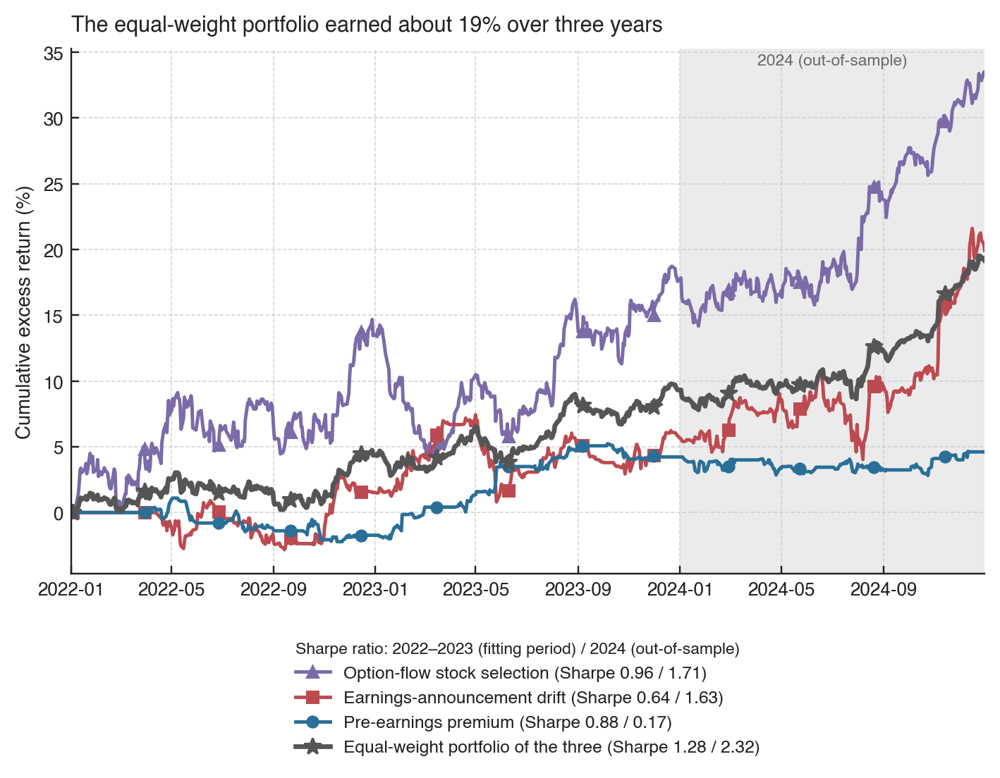
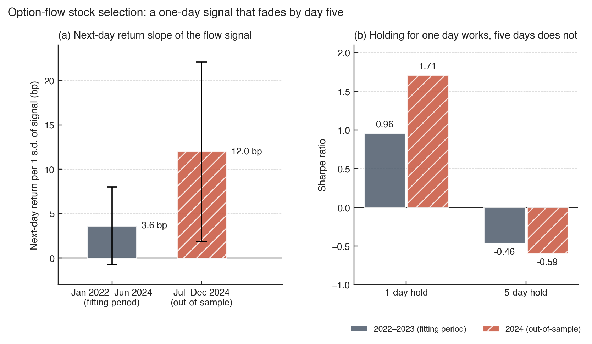
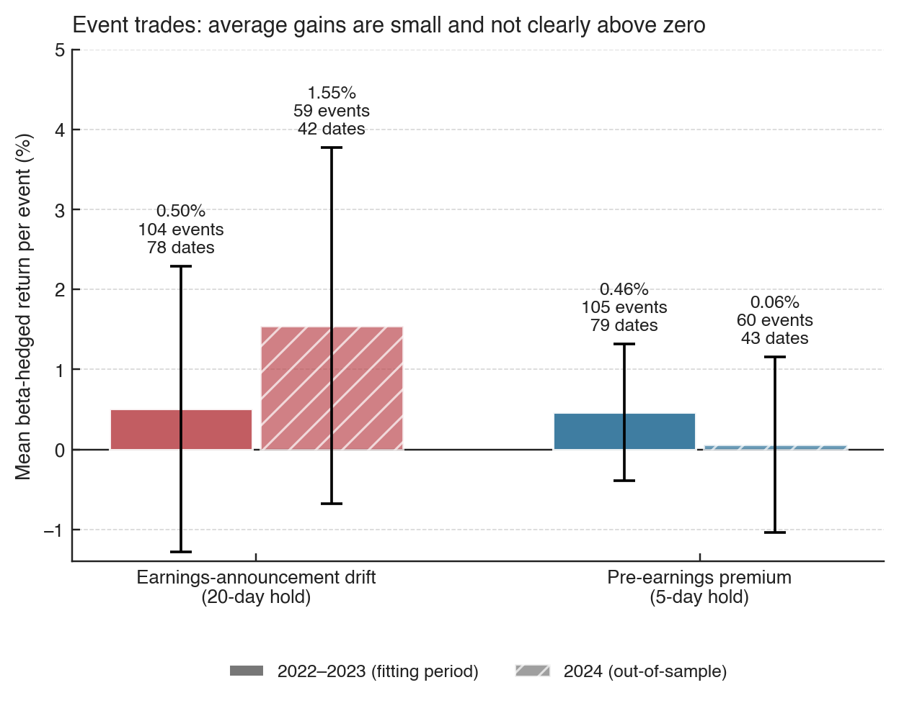
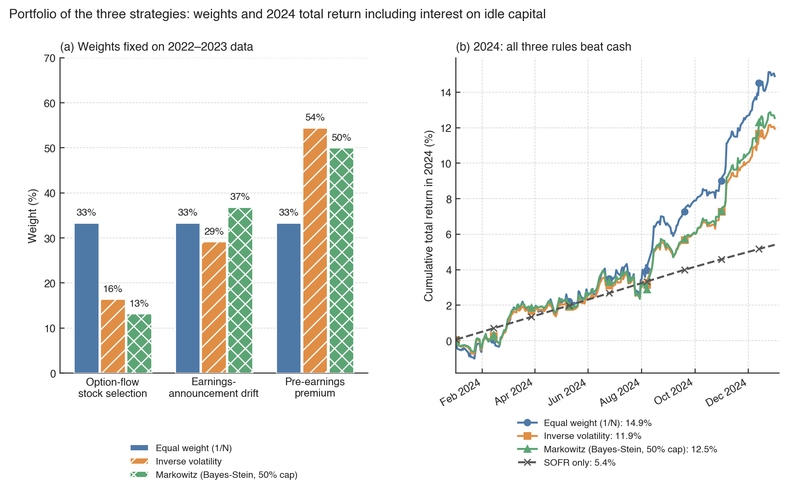

# Three option-informed equity strategies and a SOFR-anchored portfolio

This repository backtests three equity strategies on 15 large US stocks from 2022 to 2024, and one way to combine them. Two of the strategies use information from the option market and one uses the earnings calendar. Each was fitted on 2022–2023 and then run once on 2024 as an out-of-sample year. Trades fill at official auction prices and pay a realistic fee schedule.

The report is [`report/main.pdf`](report/main.pdf) (12 pages).



## The three strategies

| Strategy | Idea | 2022–2023 return / Sharpe | 2024 return / Sharpe |
|---|---|---|---|
| Option-flow stock selection | Buy stocks with net option buying, short those with net option selling; hold one day | 8.6% / 0.96 | 12.9% / 1.71 |
| Earnings-announcement drift | Trade in the direction of the stock's reaction to earnings; hold 20 days, hedged with SPY | 3.4% / 0.64 | 12.8% / 1.63 |
| Pre-earnings premium | Hold the stock for the five sessions before an announcement, hedged with SPY | 2.4% / 0.88 | 0.4% / 0.17 |

Returns are annualized returns over cash, after costs, on a $1M account.

### Option-flow stock selection

Traders with private information often prefer options, so the direction of option trading can predict the stock's next move. Each day we measure net option buying in every stock, weighting each trade by its option's delta. We then rank the stocks and trade at the next morning's opening auction: stocks above the median are bought and those below are shorted, with larger positions for stronger signals. Positions are held for one day. The book is dollar neutral and has almost no market exposure.

The strategy earned 8.6% a year in 2022–2023 and 12.9% in 2024. The signal is short-lived: held for five days instead of one, the same ranking loses money in both periods.



### Earnings-announcement drift and the pre-earnings premium

Prices tend to under-react to earnings news. The drift strategy measures the stock's return over the announcement window, net of its market exposure. It buys or shorts the stock in that direction at the next open, holds for 20 trading days, and hedges each position with SPY. The average hedged return was 0.50% per event in 2022–2023 (104 events) and 1.55% in 2024 (59 events).

Stocks have also tended to rise in the days just before scheduled earnings. The pre-earnings strategy holds stocks for the five sessions before an announcement and exits before the news. It averaged 0.46% per event in 2022–2023 but only 0.06% in 2024, which makes it the weakest of the three.



## The portfolio

Each strategy uses only part of its capital at a time, so we combine them in one account and keep all unused capital in SOFR (New York Fed fixings). Weights are set on 2022–2023 data and held through 2024.

| Rule (2024) | Total return | Return over SOFR | Sharpe |
|---|---|---|---|
| SOFR only | 5.40% | 0 | n/a |
| Equal weight | 14.91% | 8.71% | 2.32 |
| Inverse volatility | 11.94% | 6.07% | 2.00 |
| Markowitz (50% cap) | 12.55% | 6.62% | 1.94 |



We propose the equal-weight portfolio, the rule with the fewest estimated inputs, and a staged start. First, run it unchanged on 2025 data. Then, only if it beats SOFR after costs with a drawdown under 2%, allocate a small risk budget.

## How much to trust this

The evidence is suggestive, not conclusive. In 2022–2023 the $t$-statistics are 1.38, 0.87 and 1.08, all below conventional significance. We also chose these three strategies after testing 25, partly on their 2024 results. That makes the portfolio's 2024 numbers optimistic, although each strategy's own rules were fixed before 2024. The universe is small, with about 12 tradeable names a day, and the option data are a sample of all trades.

We dropped the other strategies we tested: option-premium selling, overnight and end-of-day effects, and calendar effects. Most either paid away their edge in bid–ask spreads or were positive in one period and negative in the other. The report's appendix lists them; their code and results are in the repository's git history.

## Repository layout

| Path | Contents |
|---|---|
| `engines/` | C++ engines: `option_flow.cpp` (option-flow stock selection), `earnings_events.cpp` (earnings drift and pre-earnings premium), `option_flow_v1.cpp` (earlier option-flow version), shared headers, `run_all.sh` |
| `pipeline/` | Data download (`fetch*.sh`, `file_manifest.csv`), reduction of raw tapes (`extract.py`), option-chain normalization (`normalize.py`), engine inputs (`build_inputs.py`) |
| `analysis/` | Statistics (`stats.py`), performance tables (`scorecard.py`), portfolio with SOFR cash (`portfolio.py`) |
| `notebooks/` | `figures.ipynb`, which draws the report figures |
| `data/` | Raw context tables, normalized option chains for the 15 stocks, reduced extracts the engines read, SOFR fixings |
| `results/` | Trades and daily returns per engine, performance tables, `portfolio/` |
| `report/` | Report source, `main.pdf`, figures |
| `research_style.py` | Shared figure style |

## Data

The repository includes everything needed to run the engines, the analysis and the notebook (about 194 MB). That covers:
- `data/raw/context/`: daily stock data, earnings dates, rates;
- `data/normalized/`: end-of-day option chains for the 15 stocks;
- `data/extracts/`: option-flow aggregates, auction prints and daily inputs;
- `data/sofr.csv`.

Rebuilding the extracts from scratch needs the raw vendor files, which are too large to include. The option trades and auction prints (about 24 GB) download and reduce with `pipeline/fetch_tapes.sh`. The end-of-day option chains (2.4 GB) download with `pipeline/fetch_eod_chain.sh`. Both check each file's byte count against `pipeline/file_manifest.csv`. The market data come from a third-party vendor extract and remain subject to that provider's terms.

## Running it

Set up the environment:
```bash
uv venv .venv && uv pip install -r requirements.txt
```

Reproduce the strategies, the portfolio, the figures and the report from the included data:
```bash
.venv/bin/python -I pipeline/build_inputs.py
engines/run_all.sh
.venv/bin/python analysis/scorecard.py && .venv/bin/python analysis/portfolio.py
.venv/bin/python -m jupyter nbconvert --to notebook --execute --inplace notebooks/figures.ipynb
cd report && tectonic -X compile main.tex
```

Rebuild the reduced data from the raw vendor files:
```bash
pipeline/fetch_eod_chain.sh && .venv/bin/python pipeline/normalize.py
pipeline/fetch_tapes.sh
```

The engines need only `clang++` (C++20), with no external libraries. Set `END_DATE=20231231` to run them on the fitting period alone. Every step above reproduces the stored results byte for byte.

## Outputs

| Item | Location |
|---|---|
| Trades and daily returns | `results/option_flow_*`, `results/earnings_events_*`, `results/option_flow_v1_*` |
| Performance tables | `results/scorecard_daily.csv`, `results/scorecard_events.csv`, `results/flow_fama_macbeth.csv` |
| Portfolio | `results/portfolio/`: weights, daily returns, summary |
| Report figures | `report/figures/`, drawn by `notebooks/figures.ipynb` |

The code is provided for research use. Check the bibliographic details in the report against the published versions before citing.
