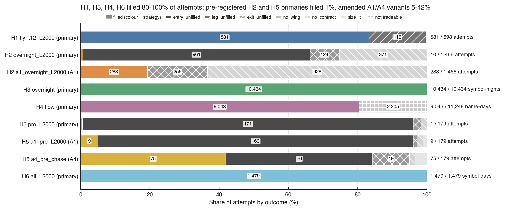
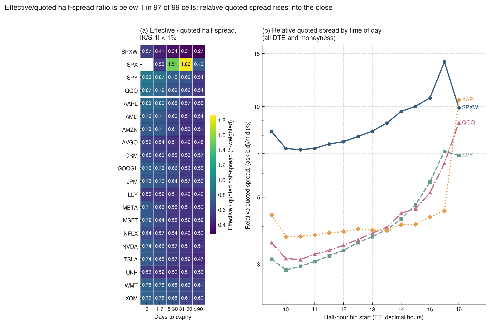
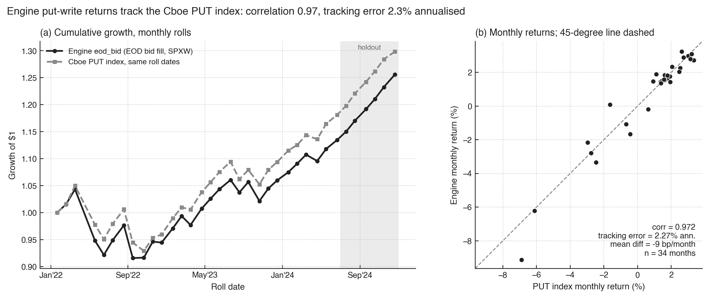
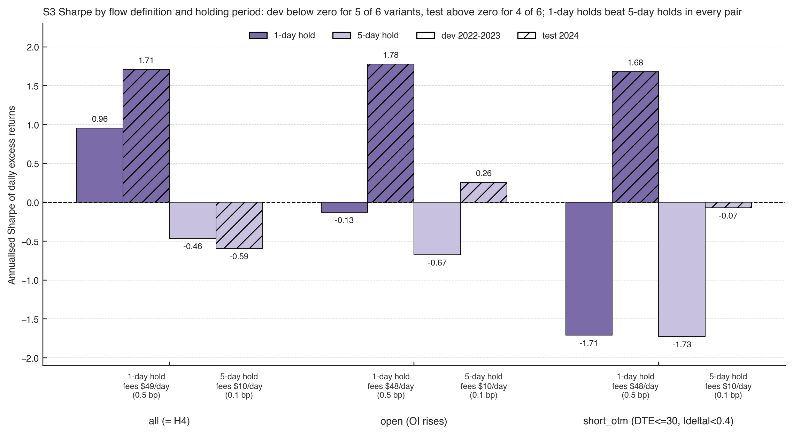
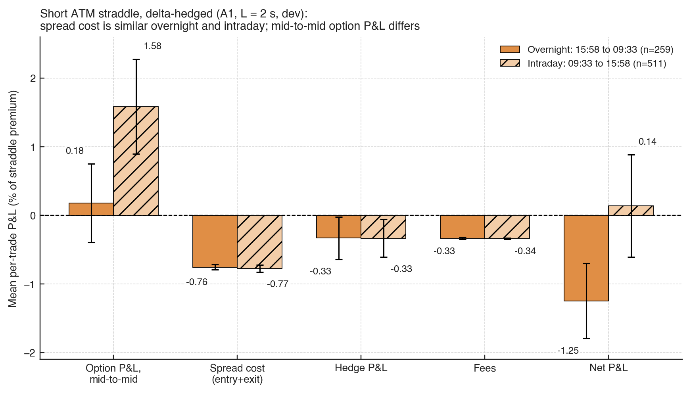
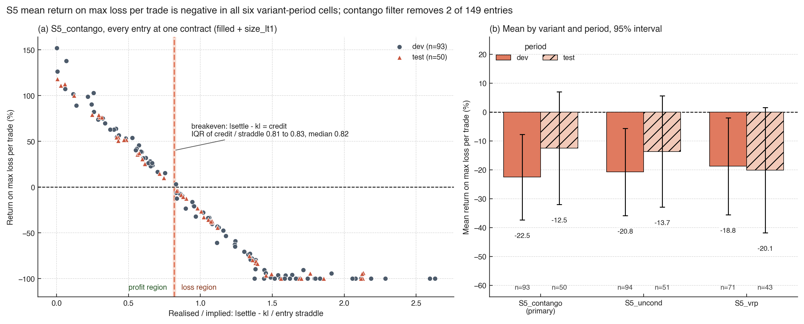
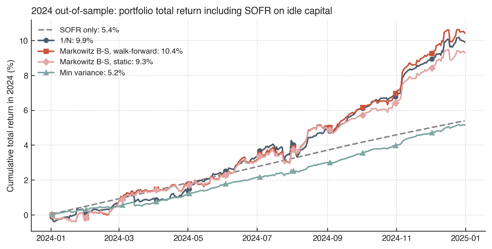

# Pre-registered option and equity strategy backtests, 2022–2024

This project asks a practical question: **which option and equity strategies survive realistic execution on real US market data?**

We test 25 strategy specifications across four research rounds ("waves"). The data are 2022–2024 US option trades with attached quotes, end-of-day option chains, and equity quotes and auction prints for 18 large stocks and ETFs. Each strategy is written down before its out-of-sample data are used. Each is filled with an explicit execution model and charged a realistic fee schedule. We then ask whether a portfolio of the strategies, with idle capital earning SOFR, adds anything over cash.

**Full report:**
- [`report/main.pdf`](report/main.pdf): 37 pages, one section per strategy.
- [`report/WRITEUP.md`](report/WRITEUP.md): the same content in Markdown.


---

## Findings in brief

1. **No strategy is confirmed.** None of the 25 specifications is both positive out of sample and statistically distinguishable from the best of the trials we ran.
2. **One lead: option order flow.** Delta-weighted signed option volume predicts next-day stock returns in a 15-name cross-section.
   - 2024H2 holdout: Sharpe 3.26, Fama–MacBeth t = 2.32.
   - 2024 test with realistic fees: Sharpe 1.71.
   - Development periods: Newey–West t of 1.38–1.48 and deflated Sharpe ≤ 0.17.
   - The signal is gone within a week.
   - It needs a 2025 sample before anyone trades it.
3. **Execution cost decides most of these strategies.**
   - Crossing the spread turned the documented overnight option premium negative: the spread alone is about four times the premium.
   - Designs that cross once and settle, or trade only in auctions, avoid most of that cost.
4. **Short-volatility premia were not there at these strikes in 2022–2024.** Realized moves on 28-day SPXW flies matched the implied straddle (mean |settle − K| 164 points against a 163-point straddle).
5. **The data limit which questions can be asked.** The option tape is a capped, trade-sampled record.
   - It supports four-leg 0DTE SPXW fills on about 80% of days.
   - It almost never fills a two-leg straddle at a pre-chosen strike.
6. **Combining strategies.** With idle capital in SOFR and weights estimated on 2022–2023 only:
   - A 25%-capped Bayes–Stein Markowitz book earned 3.7–4.7% over SOFR in 2024.
   - 1/N earned 4.2%.
   - Every sleeve's 2024 result was known when the combination was designed, so we propose paper-trading it on 2025 data rather than treating this as evidence.

---

## How the research was run

| Wave | What was tested | Out-of-sample design |
|---|---|---|
| 0 | 72 EOD configurations of credit spreads, condors and debit verticals (SPY, QQQ, SPX) | Fixed 60/20/20 split |
| 1 | 220 EOD configurations, rolling walk-forward | 6 folds, 375 sessions |
| 2 | 6 intraday-fillable hypotheses (H1–H6) and 2 foundations (F1 cost atlas, F2 engine check) | 2024H2 holdout tapes downloaded only after the code was frozen |
| 3 | 10 strategies (S1–S10) with realistic fees | 2024 test year; engines refused later dates until the freeze commit |

**Execution tiers.** Every order uses one of four fills:

| Tier | Fill |
|---|---|
| T0 | Cash settlement on the SPX close |
| T1 | Official opening or closing auction price |
| T2 | First observed quote after decision time plus latency, within 10 s, size capped at displayed size |
| T3 | End-of-day bid/ask |

Passive fills are never assumed.

**Decision rule.** A strategy is rejected if any of these holds:
- its development mean is ≤ 0;
- its out-of-sample mean is ≤ 0;
- its result disappears once its five best days are removed.

**Multiple testing.** Romano–Wolf p-values within each family, and deflated Sharpe ratios across all trials.

**What the tape can execute.** Most failed designs failed on fills before economics:



**Costs.** Option prints trade inside the quoted spread for SPXW (effective/quoted ratio 0.34–0.57) but near the touch for SPY and QQQ (0.75–0.93):



**Engine validation.** The put-write engine tracks the published Cboe PUT index (monthly correlation 0.972, tracking error 2.3% a year):



---

## Results across all strategies


Each strategy is shown with its primary (or amended) specification. Returns are annualized excess returns on a $1M reference account.

| Strategy | Dev ann. / Sharpe | Out-of-sample ann. / Sharpe | Decision |
|---|---|---|---|
| Waves 0–1: EOD credit spreads, condors, debit verticals | selected on dev | −0.4% to −4.5% | Reject all |
| H1 0DTE SPXW iron fly held to settlement | −3.1% / −0.79 | +3.0% / 0.75 | Reject |
| H2 overnight delta-hedged short straddle (amended) | −0.8% / −1.39 | +0.9% / 2.44 | Reject |
| H3 overnight stock drift via auctions | +4.8% / 0.29 | +28.8% / 2.44 | Reject (top-5 days) |
| **H4 option order flow → next-day returns** | **+7.8% / 0.90** | **+23.7% / 3.26** | **Lead, not significant** |
| H5 pre-earnings straddle (amended) | −0.1% / −0.18 | −0.5% / −2.06 | Reject |
| H6 end-of-day momentum, SPY/QQQ | +0.8% / 0.91 | −0.9% / −1.37 | Reject |
| S1 pre-earnings premium, beta-hedged | +2.4% / 0.88 | +0.4% / 0.17 | Survives rule, not significant |
| S2 earnings-announcement-return drift | +3.4% / 0.64 | +12.8% / 1.63 | Survives rule, not significant |
| S3 option flow with realistic fees, 1-day hold | +8.6% / 0.96 | +12.9% / 1.71 | Exploratory, consistent with H4 |
| S4 pre-announcement option flow | +2.2% / 0.45 | +0.2% / 0.05 | Exploratory, no effect |
| S5 SPXW iron fly to settlement, VIX-timed | −3.5% / −1.08 | −8.9% / −1.59 | Reject |
| S6 realized-minus-implied vol straddles | −2.6% / −0.73 | −6.9% / −0.95 | Reject |
| S7 0DTE pin at max-OI strike | +1.0% / 0.28 | −0.1% / −0.03 | Exploratory, no pin effect |
| S8 daytime-reversal frequency | −1.8% / −0.13 | +19.6% / 1.69 | Reject |
| S9 FOMC pre-announcement drift | +2.3% / 0.53 | −0.9% / −0.25 | Reject |
| S10 turn of the month | +3.0% / 0.36 | −3.6% / −0.61 | Reject |

### The lead: option order flow

The 1-day book holds up out of sample and after realistic fees. The same signal held five days is negative for every flow definition:



### Why the overnight option premium does not pay

A delta-hedged short straddle collects +0.18% of premium per night mid-to-mid. Crossing the spread costs 0.76%, and the hedge and fees take another 0.66%:



### Short volatility held to settlement

The 28-day SPXW iron fly loses whenever the realized move exceeds about 0.82 of the entry straddle, which happened on most entries:



---

## Combining strategies, with idle capital in SOFR

How the combination works:
- **Return:** portfolio return = SOFR accrual + Σ wᵢ × sleeve excess return, with long-only weights and Σ wᵢ ≤ 1.
- **Cash:** SOFR fixings come from the New York Fed.
- **Weights:** estimated on 2022–2023, applied to 2024 either statically or re-estimated monthly.



| Rule (2024) | Total return | Excess over SOFR | Sharpe |
|---|---|---|---|
| SOFR only | 5.40% | 0 | n/a |
| 1/N | 9.91% | 4.21% | 2.00 |
| Minimum variance | 5.16% | −0.23% | −0.41 |
| Markowitz, Bayes–Stein, 25% cap, static | 9.31% | 3.67% | 1.89 |
| Markowitz, Bayes–Stein, 25% cap, walk-forward | 10.43% | 4.69% | 2.07 |

**Reading the table.**
- Minimum variance piles into the smallest, lowest-volatility sleeves and earns about SOFR.
- Shrinkage Markowitz puts 25% each on H6 and S1 and 13–15% on S2, S3 and S9.
- One year cannot separate these rules (Sharpe standard error ≈ 1).

**Proposal** (report Section 7): freeze the rule and paper-trade it on 2025 data. Allocate a small live risk budget only if that pre-registered gate passes.

---

## Repository layout

| Path | Contents |
|---|---|
| `report/` | LaTeX source, compiled `main.pdf`, `WRITEUP.md` |
| `src/options_lab/`, `wave01/`, `tests/` | Waves 0–1: Python EOD engine, fixed-split and rolling studies, earnings study, C++ reconciliation of the rolling study (64 tests) |
| `wave2/` | Wave 2: download and reduction (`fetch*.sh`, `extract.py`, `context.py`), C++ engines (`cpp/`), inference (`analysis.py`, `scorecard.py`), pre-registration, results, notebook, figures |
| `wave3/` | Wave 3: inputs (`context3.py`), C++ engines with realistic fees, `scorecard3.py`, pre-registration, results, notebook, figures |
| `alloc/` | Allocation across sleeves with SOFR cash: script, weights, sleeve statistics, daily portfolio returns, notebook, figures |
| `research_style.py` | Shared figure style |
| `data/` | Context tables, normalized EOD option panels (`quotes_SPX.parquet` via Git LFS) |
| `reports/` | Wave 0–1 reports and outputs, dataset audit, file manifest with download links and byte counts, data dictionary |

## Data

**Included:**
- `data/raw/context/` (21 MB);
- `data/normalized/` (326 MB);
- `wave2/extracts/` (534 MB): every reduced input the engines read;
- `wave2/external/`: Cboe PUT index and SOFR.

**Not included**, because of size (re-download with byte-count checks against `reports/dataset_audit/file_manifest.csv`):
- option and equity tapes, about 27 GB: `wave2/fetch_dev.sh`, `wave2/fetch_holdout.sh`;
- EOD option chains, 2.4 GB: `./fetch_eod_chain.sh`.

## Running it

Setup:
```bash
uv venv .venv && uv pip install -r requirements.txt
```

Steps 2–5 need only the included data. Steps 1 and 7 need the downloads above.

1. Optional: rebuild the extracts from raw tapes.
   ```bash
   wave2/fetch_dev.sh && wave2/fetch_holdout.sh && wave2/run_extracts.sh
   ```
2. Wave-2 engines, then the decision rules.
   ```bash
   wave2/cpp/build_and_run.sh && .venv/bin/python wave2/scorecard.py
   ```
3. Wave-3 inputs, engines over the full sample, then the decision rules.
   ```bash
   .venv/bin/python -I wave3/context3.py
   W3_END=20241231 wave3/cpp/build_and_run.sh && .venv/bin/python wave3/scorecard3.py
   ```
4. Allocation across sleeves.
   ```bash
   .venv/bin/python alloc/allocate.py
   ```
5. Notebooks: figures and tables.
   ```bash
   .venv/bin/python -m jupyter nbconvert --to notebook --execute --inplace \
     wave2/notebooks/wave2_report.ipynb wave3/notebooks/wave3_report.ipynb alloc/notebooks/allocation_report.ipynb
   ```
6. Report.
   ```bash
   cd report && tectonic -X compile main.tex
   ```
7. Waves 0–1, run from the repository root.
   ```bash
   ./fetch_eod_chain.sh && .venv/bin/python src/options_lab/normalize.py && .venv/bin/python src/options_lab/normalize.py --single
   .venv/bin/python wave01/run_grid.py && .venv/bin/python wave01/final_eval.py && .venv/bin/python wave01/run_rolling_research.py
   ```

The C++ engines need only `clang++` with `-std=c++17` (wave 2) or `-std=c++20` (wave 3); there are no external libraries.

## Outputs

| Wave | Outputs |
|---|---|
| Wave 2 | `wave2/results/`: trades and daily returns per strategy, `decisions.csv`, `scorecard_*.csv` |
| Wave 3 | `wave3/results/`: trades and daily returns per engine, `decisions3.csv`, `scorecard3_*.csv` |
| Allocation | `alloc/*.csv` |
| Waves 0–1 | `reports/` (trade blotter, daily portfolio, `rolling_research/`, scorecards) |
| Figures | `wave2/figures/`, `wave3/figures/` and `alloc/figures/`, each with `figure_notes.md` describing the data checks behind every figure |

## Licence and data

The code is provided for research use. The market data come from a third-party vendor extract and remain subject to that provider's terms. Bibliographic details in the report should be checked against the published versions before citing.
