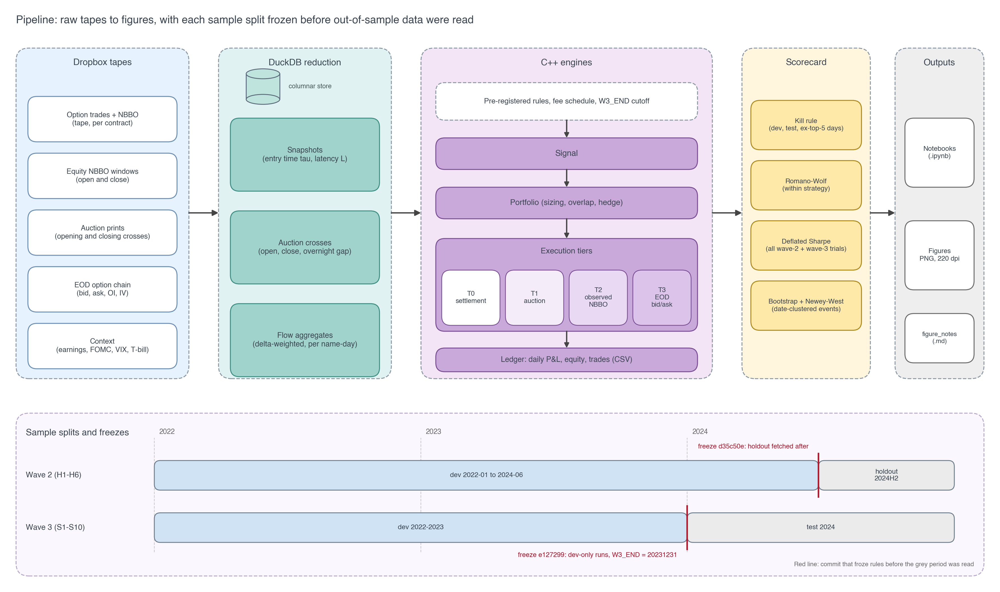
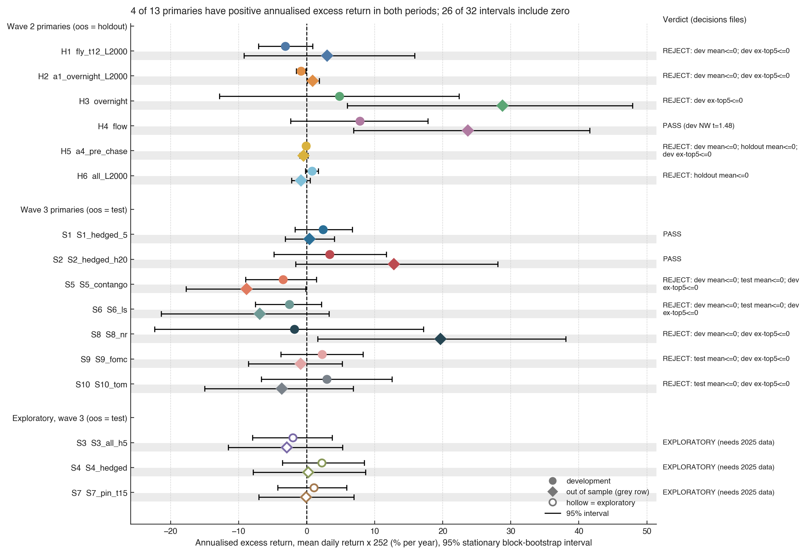

# Options and equity strategy research on the `Data_to_share` tapes (2022–2024)

This repository holds four rounds ("waves") of pre-registered backtests on one dataset: US option trades with attached NBBO, EOD option chains, equity quotes around the open and close, and auction prints for 18 large US equities and ETFs, 2022-01-03 to 2024-12-31. Across 25 strategy specifications, **none clears a confirmatory bar** (out-of-sample and statistically distinguishable from the best of many trials) after realistic execution and fees.

One lead remains: delta-weighted option order flow predicts next-day stock returns.
- **2024H2 holdout (wave 2, H4):** Sharpe 3.26 and Fama–MacBeth t = 2.32.
- **2024 test with realistic fees (wave 3, S3, 1-day hold):** Sharpe 1.71.
- **Development periods:** Newey–West t = 1.48 (wave 2) and 1.38 (wave 3), with deflated Sharpe ≤ 0.17.

It needs a 2025 sample before anyone trades it.

The second contribution concerns execution. The option tape is a capped, trade-sampled record. It supports four-leg 0DTE SPXW fills on about 80% of days, but almost never fills a two-leg straddle at a pre-chosen strike. Several textbook strategies are therefore not testable on this data, independent of their economics.

> Engines are C++17/20 (`wave2/cpp`, `wave3/cpp`). Inference is in Python (`wave2/analysis.py`). Figures and tables live in executed notebooks (`wave2/notebooks`, `wave3/notebooks`). Each wave was frozen in git before its out-of-sample data was used: wave 2 at `d35c50e` (holdout tapes not yet downloaded) and wave 3 at `e127299` (engines capped at 2023-12-31 until that commit).



---

## Contents
1. [Data and what it can execute](#1-data-and-what-it-can-execute)
2. [Research protocol](#2-research-protocol)
3. [Implementation](#3-implementation)
4. [Results overview](#4-results-overview)
5. [Strategy write-ups](#5-strategy-write-ups)
6. [What we learned](#6-what-we-learned)
7. [Limitations and next steps](#7-limitations-and-next-steps)
8. [Reproduce](#8-reproduce)
9. [References](#9-references)

---

## 1. Data and what it can execute

The supplied folder has 21 datasets (88.5 GB, 4.74 billion rows; audit in `reports/dataset_audit/ASSESSMENT.md`).

| Dataset | Content | Role here |
|---|---|---|
| EOD option chain | bid/ask, IV, Greeks, OI for 20 underlyings | Daily signals; T3 fills; daily marks |
| Option trades + NBBO | every sampled print with the prevailing bid/ask and sizes | T2 fills, effective spreads, signed order flow |
| Equity NBBO | quotes 09:29–09:35 and 15:55–16:01 for 17 names (no GOOGL) | Stock hedges and entries near the open and close |
| Equity auction-window trades | prints around the opening and closing crosses | T1 auction fills |
| Context | daily equity OHLC, factors, rates, VIX, earnings dates, fundamentals | Signals, corporate actions, benchmarks |

**Fill tiers.** Every backtest declares how each order is filled.

| Tier | Mechanism | Used for |
|---|---|---|
| T0 | Cash settlement on the SPX close (SPXW PM only) | Option exits held to expiry |
| T1 | Official opening or closing cross price | Stock entries and exits |
| T2 | First observed NBBO strictly after decision time + latency, within 10 s; buy at the ask, sell at the bid; size ≤ displayed | Intraday option and stock orders |
| T3 | EOD bid/ask (buy ask, sell bid) | Daily option strategies |

Passive fills are never assumed.

**Measured data facts that shaped the designs:**
- **Clock:** the option tape is in US/Eastern time. SPY option prints start at 09:30:00.
- **Capped sample:** the tape holds about 500,000 prints per day for SPY, QQQ and TSLA, and SPY options are missing on 193 of 625 development days. In a 10-second window only 30–45 SPY contracts and 3–30 contracts per single name show a print, so quotes are visible only at sampled prints.
- **Effective vs quoted spreads:** SPXW prints well inside the quoted spread (effective/quoted half-spread 0.57 at 0DTE ATM, 0.34 at 8–30 DTE). SPY and QQQ print near the touch (0.75–0.93) (`wave2/figures/fig02_cost_atlas.png`).
- **Auction data:** closing-cross prints equal the official daily close on 100% of tested days. XOM and LLY usually lack a primary-exchange cross, and GOOGL has no equity quote or auction data.
- **Share-class mixing:** `sym_root` mixes share classes. JPM preferred shares near $20 appear in both the JPM quote stream and the auction prints, and both are filtered.
- **EOD snapshot time:** EOD chain quotes match the tape's last NBBO before 16:00 or 16:15 only 7–21% of the time, so the snapshot time cannot be determined.

**Transaction costs.** Wave 2 used placeholder option fees. Wave 3 uses a realistic schedule (verify against your broker):

| Item | Cost |
|---|---|
| Option commission | $0.65 per contract per side |
| SPX/SPXW exchange + OCC + ORF | $0.66 + $0.025 + $0.003 per contract |
| Other option taker fees | $0.50 + $0.028 per contract |
| Stock | $0.0035 commission + $0.0002 clearing + $0.0010 auction fee per share |
| Sells | SEC fee $27.80 per $1M, FINRA TAF $0.000166 per share (capped at $8.30 per trade) |
| Borrow | 0.40% per year on short notional |

---

## 2. Research protocol

| Wave | Design | Out-of-sample |
|---|---|---|
| 0 | 72 EOD configurations (verticals, condors) on SPY/QQQ/SPX, fixed 60/20/20 split | 2024-06 → 2024-12 test |
| 1 | 220 EOD configurations, rolling 252/63-session walk-forward | 6 folds, 375 sessions |
| 2 | 6 intraday-fillable hypotheses (H1–H6) and 2 foundations (F1, F2) | 2024-07 → 2024-12; tapes **not downloaded** until the freeze commit `d35c50e` |
| 3 | 10 strategies (S1–S10), realistic fees | 2024 test year; engines refused dates after 2023-12-31 until the freeze commit `e127299` |

**Pre-registration.** Each strategy was written down before its engine ran, in the order economic intuition → signal → portfolio construction → execution → risk → evaluation (`wave2/prereg/PREREGISTRATION.md`, `wave3/PREREGISTRATION.md`). Each has one primary specification. Secondary variants are reported and corrected for multiplicity.

**Amendments.** Changes made after a run are dated in the pre-registration files with the reason.
- A1–A4 (wave 2) respond only to measured fill availability. Example: chosen-strike straddles filled on about 1% of nights.
- B1 (wave 3) changes the denominator of one per-trade test; it was made after seeing development totals and is disclosed as such.
- The original specifications are always reported alongside the amended ones.

**Inference.**
- Newey–West t-statistics (5 lags) and stationary block-bootstrap confidence intervals (mean block 10).
- Event returns are clustered by date; Fama–MacBeth regressions are used for cross-sections.
- Romano–Wolf stepdown p-values are computed within each strategy family.
- Deflated Sharpe ratios are computed against all 88 wave-2 and wave-3 variants. Waves 0 and 1 add 292 earlier trials, so the true multiplicity is higher still.

**Kill rule.** A primary is rejected if any of the following holds:
- its development mean is ≤ 0;
- its out-of-sample mean is ≤ 0;
- its development result disappears once the five best days are removed.

Surviving the kill rule is necessary, not sufficient. "Confirmed" would additionally require a deflated Sharpe near 1 and a Romano–Wolf p < 0.05. Nothing here meets that.

**What 2022–2024 can detect.** With three years of data the standard error of an annualized Sharpe ratio is about 0.6, so only strategies with Sharpe ≳ 1.2 can be confirmed at 5%. Event and cross-sectional designs gain power from breadth. The 15-name universe limits that gain.

---

## 3. Implementation

```
wave2/
  fetch.sh, fetch_dev.sh, fetch_holdout.sh   manifest-driven Dropbox download with byte-count verification
  extract.py                                 DuckDB reduction: decision-time quote snapshots, auction crosses, flow, cost atlas
  context.py                                 small daily inputs (sessions, equity, earnings, H4 signals, GEX, F2 chain)
  cpp/common.hpp                             CSV loader, sessions, T2 snapshot lookup, parity forward, Black-Scholes, ledger
  cpp/equity.hpp                             auction crosses (validated against official open/close), corporate actions
  cpp/{f2,h1..h6}_*.cpp                      one engine per strategy: signal -> portfolio -> execution -> accounting
  analysis.py, scorecard.py                  inference and pre-registered decisions
  notebooks/wave2_report.ipynb, figures/
wave3/
  context3.py                                SPXW and single-name chains, OI, flow measures, VIX
  cpp/w3.hpp                                 realistic fees, W3_END guard, beta, mark-to-market stock book
  cpp/{s_events,s3_flow,s5_spxw_vix,s6_straddle_gs,s7_pin,s_calendar}.cpp
  scorecard3.py, notebooks/wave3_report.ipynb, figures/
src/options_lab/, wave01/                   waves 0 and 1 (Python EOD engine, 64 tests)
```

**Snapshots.** For a decision time τ and latency L, `extract.py` stores, per contract, two quotes:
- the last quote in [τ − 120 s, τ), which is information known at τ;
- the first quote in [τ + L, τ + L + 10 s], which is the T2 fill quote.

Latency is run at L ∈ {0.5 s, 2 s, 10 s}. A 120 s "chase" window is stored for the amended exits.

**Forward and strike selection.** Strikes use the put–call-parity forward F = K* + C − P from pre-decision mids, so no spot feed is needed for SPX.

**Accounting.** Each strategy runs a $1M reference account per variant, and idle cash earns the 1-month T-bill.
- Stock positions (wave 3) are marked to the official close each day.
- Option positions are marked to the EOD mid and realized at settlement or exercise.
- Reported returns are daily excess returns.

**Checks.**
- **Unit self-checks:** the payoff identities, implied-volatility round-trips and statistical routines each carry an assert.
- **Accounting reconciliations:**
  - The 0DTE settlement close matches the intraday parity forward to within about 2 bp on average.
  - The wave-3 stock book reconciles exactly: price P&L $111,375 − fees $861 + dividends $797 = ledger $111,311.
  - The H2 P&L decomposition identities hold to within $0.005.
  - A hand-recomputed S5 trade matches the engine to the cent.
- **External benchmark:** the put-write engine tracks the published Cboe PUT index with monthly correlation 0.972 and tracking error 2.3% per year (F2).
- **Bugs caught by mechanics checks** (before any out-of-sample run):
  - preferred-share prices contaminating the JPM stream;
  - a session-index leak in the wave-3 date guard;
  - a missing equity-quote window that blanked H6.

---

## 4. Results overview



Each strategy below is listed with its primary (or amended) specification. "Dev" is the development period; "OOS" is the wave-2 2024H2 holdout or the wave-3 2024 test. Returns are annualized excess returns on the $1M reference account.

| Wave | Strategy | Dev ann. / Sharpe / NW t | OOS ann. / Sharpe | Decision |
|---|---|---|---|---|
| 0 | EOD put/call credit spreads, condor, debit vertical (4 structures) | selected on dev | −0.4% to −4.5% | Reject all |
| 1 | Rolling EOD grid (5 structures) | selected per fold | −1.0% to −3.7%; call credit spreads t = −2.21 | Reject all |
| 2 | F2 put-write engine check | corr 0.972 with Cboe PUT | n/a | Engine valid |
| 2 | H1 0DTE SPXW iron fly, held to settlement | −3.1% / −0.79 / −1.42 | +3.0% / 0.75 | Reject |
| 2 | H2 overnight delta-hedged short straddle (A1) | −0.8% / −1.39 / −2.22 | +0.9% / 2.44 | Reject; original rule untestable (10 fills) |
| 2 | H3 overnight equity drift (auctions) | +4.8% / 0.29 / 0.50 | +28.8% / 2.44 | Reject (top-5 days) |
| 2 | **H4 option order flow → next-day returns** | **+7.8% / 0.90 / 1.48** | **+23.7% / 3.26** | **Survives kill rule; not significant** |
| 2 | H5 pre-earnings straddle (A4) | −0.1% / −0.18 / −0.30 | −0.5% / −2.06 | Reject; original rule untestable (1 fill) |
| 2 | H6 end-of-day momentum, SPY/QQQ | +0.8% / 0.91 / 1.50 | −0.9% / −1.37 | Reject |
| 3 | S1 pre-earnings premium, beta-hedged | +2.4% / 0.88 / 1.08 | +0.4% / 0.17 | Survives kill rule; not significant |
| 3 | S2 earnings-announcement-return drift | +3.4% / 0.64 / 0.87 | +12.8% / 1.63 | Survives kill rule; not significant |
| 3 | S3 option flow, realistic fees (1-day hold, exploratory) | +8.6% / 0.96 / 1.38 | +12.9% / 1.71 | Exploratory; consistent with H4 |
| 3 | S4 pre-announcement option flow (exploratory) | +2.2% / 0.45 / 0.66 | +0.2% / 0.05 | Exploratory; no effect |
| 3 | S5 SPXW iron fly held to settlement, VIX-timed | −3.5% / −1.08 / −1.37 | −8.9% / −1.59 | Reject |
| 3 | S6 RV − IV straddles exited by exercise | −2.6% / −0.73 / −1.06 | −6.9% / −0.95 | Reject |
| 3 | S7 0DTE pin at max-OI strike (exploratory) | +1.0% / 0.28 / 0.38 | −0.1% / −0.03 | Exploratory; no pin effect |
| 3 | S8 daytime-reversal frequency | −1.8% / −0.13 / −0.20 | +19.6% / 1.69 | Reject |
| 3 | S9 FOMC pre-announcement (24 events) | +2.3% / 0.53 / 0.74 | −0.9% / −0.25 | Reject |
| 3 | S10 turn-of-the-month | +3.0% / 0.36 / 0.55 | −3.6% / −0.61 | Reject |

Equity curves: `wave2/figures/fig04_equity_curves.png` and `wave3/figures/fig12_w3_equity.png`. Full scorecards: `wave2/results/decisions.csv` and `wave3/results/decisions3.csv`.

### 4.1 Combining strategies, with idle capital in SOFR

Most sleeves commit only a fraction of their capital, so `alloc/allocate.py` combines the 13 primary sleeves as follows:
- **Return:** portfolio return = SOFR accrual + Σ wᵢ × sleeve excess return, with wᵢ ≥ 0 and Σ wᵢ ≤ 1.
- **Cash:** SOFR fixings come from the New York Fed (actual/360).
- **Weights:** estimated on 2022–2023 only and applied to 2024, either static or re-estimated monthly on an expanding window.

| Rule (2024, out-of-sample) | Total return | Excess over SOFR | Sharpe | Max DD |
|---|---|---|---|---|
| SOFR only | 5.40% | 0 | n/a | 0 |
| 1/N | 9.91% | 4.21% | 2.00 | −0.89% |
| Minimum variance (Ledoit–Wolf) | 5.16% | −0.23% | −0.41 | −0.23% |
| Markowitz, Bayes–Stein means, 25% cap, static | 9.31% | 3.67% | 1.89 | −0.74% |
| Markowitz, Bayes–Stein means, 25% cap, walk-forward | 10.43% | 4.69% | 2.07 | −0.89% |
| 1/N scaled to 5% volatility (×2.46) | 16.75% | 10.37% | 2.00 | −2.29% |

**Reading the table.**
- Minimum variance loads on the small, low-volatility straddle books and earns about SOFR.
- Shrinkage Markowitz puts its weight on H6 and S1 (25% each, the cap), then S2, S3 and S9 (13–15% each).
- **Caveat:** this is weaker than a clean out-of-sample test. No weight uses 2024 returns, but every sleeve's 2024 result was known when the allocation study was designed, and one year of data cannot separate these rules (Sharpe standard error ≈ 1).

**Proposal** (detail in `report/allocation.tex`): all undeployed capital stays in SOFR, and the shrinkage-Markowitz and 1/N rules are frozen and paper-traded on 2025 data. A live risk budget (5% volatility, S3 and S2 only, each with a kill switch) follows only if that pre-registered gate passes.

---

## 5. Strategy write-ups

Each entry follows the same structure: **intuition and literature**, **specification** (signal and trading rules), **implementation**, and **out-of-sample testing**. Numbers are net of the stated costs.

### 5.1 Waves 0 and 1: EOD defined-risk option spreads
- **Intuition.** Index options carry a variance risk premium (Carr & Wu 2009; Bollerslev, Tauchen & Zhou 2009). Defined-risk short-premium structures might harvest it, and debit verticals might express trend.
- **Specification.** Put and call credit spreads, iron condors and call/put debit verticals on SPY, QQQ and SPX. Short-leg delta 0.15–0.30 and 30–45 DTE. Filters include IV percentile, implied-minus-realized volatility, trend and skew. Exits at 50% of credit, a 2× loss stop, or ≤ 5 DTE.
- **Implementation.** Python EOD engine (`src/options_lab`). Signals use the prior close; fills are on the next EOD snapshot at buy-ask / sell-bid, with per-leg fees.
- **Out-of-sample.**
  - Wave 0: all four structures were rejected on the fixed test window (−0.36% to −4.50% annual excess); deflated Sharpe ≈ 0 over 72 trials.
  - Wave 1: rolling selection over 220 configurations gave negative excess returns for every structure across 6 folds; call credit spreads were the worst at NW t = −2.21 (`reports/06_final_research_report.md`, `reports/rolling_research/`).
  - Entering and exiting across the full spread cost more than any premium these structures captured.

### 5.2 F1 and F2: execution-cost atlas and engine validation
- **F1.** Following Muravyev & Pearson (2020), we measured effective against quoted spreads over about 1.5 billion sampled development-period prints.
  - SPXW prints well inside the spread, SPY and QQQ near the touch, single names in between (`wave2/figures/fig02_cost_atlas.png`).
  - Other traders' effective spreads are not our fills, so T2 still crosses the full spread.
- **F2.** A monthly cash-secured SPXW put-write, sold at the EOD bid and settled on the SPX close, tracks the Cboe PUT index:
  - monthly correlation 0.972, tracking error 2.3% per year, mean gap −9 bp per month over 34 rolls (`wave2/figures/fig03_putwrite_validation.png`);
  - the gap is in line with PUT's AM settlement and VWAP sale window, which we do not replicate.
  - We read this as evidence that the option accounting is sound.

### 5.3 H1: 0DTE SPXW premium held to settlement
- **Intuition.** Same-day index options may embed a variance premium paid by retail traders and hedgers for convexity (Bandi, Fusari & Renò 2023; Beckmeyer, Branger & Gayda 2023; Vilkov 2023). Holding to cash settlement pays the spread once.
- **Specification.**
  - At 12:00 ET, sell an iron fly: short call and put at the parity strike, wings at the strikes nearest ±1.5 × the straddle mid.
  - Max loss is capped at ≤ 0.5% of equity.
  - Secondaries: entry at 10:00, 14:00 or 15:00; a condor; a filter on implied versus trailing realized move.
- **Implementation.** `wave2/cpp/h1_0dte.cpp`. Fills are T2 on all four legs (all must fill) with T0 settlement. Four-leg fills succeeded on about 80% of days.
- **Out-of-sample.**
  - Development mean return on risk was −4.0% per trade (date-clustered t = −1.22), with annual excess −3.1%.
  - The holdout was +3.0% (CI −9% to +16%).
  - Later entries were closer to zero, and the condor was ≈ 0. None of the 15 variants is significant after Romano–Wolf (`wave2/figures/fig05_h1_entry_latency.png`). Rejected.

### 5.4 H2: overnight versus intraday option premium
- **Intuition.** Muravyev & Ni (2020) find delta-hedged option returns are strongly negative overnight. Jones & Shemesh (2018) report lower option returns over non-trading periods. Short sellers should therefore earn overnight.
- **Specification.**
  - Short an ATM SPY/QQQ straddle at 15:58 and close it at 09:33 the next session, delta-hedged with shares at both times.
  - Size so a 3% gap costs ≤ 0.5% of equity.
  - Contrast: the same trade held 09:33 → 15:58.
- **Implementation.** `wave2/cpp/h2_overnight.cpp`. Options are T2. The stock hedge is T2 against the equity NBBO, which exists exactly in the open and close windows.
  - The pre-registered contract rule filled 10 nights.
  - Amendment A1 picks among contracts with observed quotes and allows a 120 s exit chase.
- **Out-of-sample.**
  - A1 overnight lost 1.25% of premium per night in development (date-clustered t = −4.0). The decomposition (`wave2/figures/fig06_h2_decomposition.png`):

    | Component, % of premium per night | Overnight | Intraday |
    |---|---|---|
    | Mid-to-mid option P&L | +0.18 | +1.58 |
    | Spread cost | −0.76 | −0.77 |
    | Hedge | −0.33 | −0.33 |
    | Fees | −0.33 | −0.34 |

  - In this sample the option-value decline appears mostly during the session, opposite to Muravyev & Ni. The 09:33 opening quote may carry an opening-IV premium.
  - Rejected. The spread alone is about four times the overnight premium.

### 5.5 H3: overnight equity drift with auction fills
- **Intuition.** A large share of the equity premium accrues overnight (Lou, Polk & Skouras 2019; Cliff, Cooper & Gulen 2008). Auctions allow entry and exit at a single price.
- **Specification.** Equal-weight long at the closing cross, sold at the next opening cross, across 14 single names plus SPY and QQQ; participation ≤ 1% of lagged cross size. Secondaries: overnight momentum, and spread crossing instead of auctions.
- **Implementation.** `wave2/cpp/h3_overnight_eq.cpp`, T1 fills, split/dividend adjustment from the daily panel.
- **Out-of-sample.**
  - Development overnight returns were +4.8% per year (CI −12.8% to +22.2%), against +15.3% for the intraday leg, the reverse of the documented pattern (`wave2/figures/fig07_h3_overnight_intraday.png`).
  - The 2024H2 result (+28.8%) coincides with a broad rally and does not survive removing the five best days. Rejected.

### 5.6 H4 and S3: option order flow and next-day stock returns
- **Intuition.** Informed traders use options for leverage and concealment, so option order flow and implied-volatility asymmetries can lead stock prices (Easley, O'Hara & Srinivas 1998; Pan & Poteshman 2006; Cremers & Weinbaum 2010; Xing, Zhang & Zhao 2010; Johnson & So 2012).
- **Specification.**
  - Signal: day-t delta-weighted signed option volume over total delta-weighted volume, with trades signed by the quote rule.
  - Portfolio: a cross-sectional, dollar-neutral rank book, held from the t+1 opening cross to the t+2 opening cross.
  - Secondaries: the IV spread, the IV smirk and a composite.
- **Implementation.** `wave2/cpp/h4_info.cpp`, re-implemented in wave 3 with realistic fees as `wave3/cpp/s3_flow.cpp`. Variants:
  - opening-flow (contracts whose OI rises; OI timing is an assumption);
  - short-dated OTM flow;
  - 5-day overlapping holds.
- **Out-of-sample.**

  | Sample | Ann. excess | Sharpe | NW t | Other |
  |---|---|---|---|---|
  | Wave 2 dev | +7.8% | 0.90 | 1.48 | DSR 0.17; Romano–Wolf p = 0.36 |
  | Wave 2 holdout (2024H2) | +23.7% | 3.26 | | bootstrap CI +7% to +42% |
  | Wave 3 dev, realistic fees, 1-day hold | +8.6% | 0.96 | 1.38 | |
  | Wave 3 test (2024), 1-day hold | +12.9% | 1.71 | 1.82 | |

  - Fama–MacBeth slope on the 1σ flow signal: 3.6 bp per day in dev (t = 1.63) and 12 bp in the holdout (t = 2.32) (`wave2/figures/fig08_h4_fama_macbeth.png`).
  - The effect is gone within a week: 5-day holds are negative for every flow definition (`wave3/figures/fig15_s3_decay.png`).
  - The opening-flow and short-dated-OTM refinements do not improve on raw flow in development.
  - We classify this as a lead. It survives the kill rule and realistic fees, but its development evidence is not distinguishable from the best of the trials we ran, and it is the one wave-2 result we went on to refine. The sample is 15 names, typically about 10 tradeable.

### 5.7 H5: pre-earnings implied-volatility run-up
- **Intuition.** Implied volatility rises into earnings announcements. Straddles bought days before and sold before the event earn the run-up without holding the event jump (Gao, Xing & Zhang 2018; see also Dubinsky, Johannes, Kaeck & Seeger 2019).
- **Specification.** Buy an ATM straddle five sessions before the last pre-announcement session, at 15:55. Sell it at 15:55 before the announcement. Secondary: hold through the event.
- **Implementation.** `wave2/cpp/h5_earnings.cpp`.
  - The pre-registered rule filled 1 event.
  - Amendments A1, A3 and A4 (strike from quoted contracts, a stock-mid reference, 120 s windows) reach 75 fills.
- **Out-of-sample.**
  - A4 lost 0.8% of premium per event in dev (t = −0.81) and 6.3% in the holdout (11 events).
  - Holding through the event was negative, consistent with the wave-0 EOD earnings study. Rejected.

### 5.8 H6: end-of-day momentum
- **Intuition.** Negative-gamma dealer hedging and late-informed trading may push the day's move further into the close (Gao, Han, Li & Zhou 2018; Baltussen, Da, Lammers & Martens 2021).
- **Specification.**
  - Signal: the sign of the return from the prior close to 15:55:00.5 (amendment A2: the quote window opens at 15:55).
  - Trade: 50% of equity each in SPY and QQQ, entered at the 15:55 NBBO (size ≤ displayed) and exited at the closing cross.
  - Secondary: trade only on negative-GEX days.
- **Implementation.** `wave2/cpp/h6_eodmom.cpp`.
- **Out-of-sample.**
  - Development Sharpe 0.91 (t = 1.50), at the 99.3rd percentile of 1,000 random-sign placebos.
  - Holdout Sharpe −1.37, at the 24th percentile (`wave2/figures/fig10_h6_placebo.png`).
  - Displayed-size caps filled about 47% of the target notional. Rejected.

### 5.9 S1: pre-earnings announcement premium
- **Intuition.** Stocks earn higher returns in the days before scheduled earnings, consistent with compensation for announcement risk and with attention-driven buying (Frazzini & Lamont 2007; Barber, De George, Lehavy & Trueman 2013).
- **Specification.** Buy at the close five sessions before the last pre-announcement session and sell at that session's close. Short SPY at the 60-day beta. 10% of equity per event.
- **Implementation.** `wave3/cpp/s_events.cpp`, official-close fills, daily marked book.
- **Out-of-sample.**
  - Development hedged event return was +0.46% (105 events, clustered t = 1.47), with annual excess +2.4% (NW t = 1.08).
  - The 2024 test was +0.06% per event (60 events, t = 0.02) and +0.4% annualized.
  - Unhedged, development was +1.10% per event (t = 2.28), mostly market exposure, and the 2024 test was ≈ 0 (`wave3/figures/fig13_w3_events.png`).
  - Survives the kill rule narrowly; the premium did not appear in 2024. Not significant.

### 5.10 S2: earnings-announcement-return drift
- **Intuition.** Prices under-react to earnings news. The market's own reaction serves as a surprise measure that needs no analyst forecasts, which this dataset lacks (Brandt, Kishore, Santa-Clara & Venkatachalam 2008; Chan, Jegadeesh & Lakonishok 1996).
- **Specification.** Measure the beta-adjusted return over the announcement window. Take its sign at the next opening cross and hold 20 sessions, beta-hedged. Secondaries: |EAR| > 2%; a 40-session hold.
- **Implementation.** `wave3/cpp/s_events.cpp`. If the opening cross is missing, the order fills at that day's close.
- **Out-of-sample.**
  - Development +0.50% per event (t = 0.59; annual +3.4%, Sharpe 0.64).
  - Test +1.55% per event (59 events, t = 1.32; annual +12.8%, Sharpe 1.63).
  - The |EAR| > 2% subset is similar. The 40-session hold was negative in development and positive in the test.
  - Survives the kill rule; not significant. Direction-consistent with the literature, but about 100 development events give low power.

### 5.11 S4: pre-announcement option flow
- **Intuition.** Informed trading concentrates in options before scheduled news (Roll, Schwartz & Subrahmanyam 2010; Johnson & So 2012).
- **Specification.** Take the sign of delta-weighted flow over the five sessions before the announcement. Enter at the pre-announcement close and exit at the first opening cross afterwards, beta-hedged.
- **Implementation.** `wave3/cpp/s_events.cpp`. Exploratory, because it is derived from H4.
- **Out-of-sample.** +0.41% per event in development (t = 0.38) and +0.07% in 2024. No effect at this sample size.

### 5.12 S5: SPXW premium held to settlement, timed by the VIX term structure
- **Intuition.** The variance risk premium is larger, and short-volatility exposure safer, when the VIX term structure is in contango (Carr & Wu 2009; Johnson 2017). At 8–30 DTE, crossing the spread once costs about 0.6% of premium against about 8% for a 0DTE round trip (F1).
- **Specification.** Each Friday, sell a ~28-DTE SPXW iron fly at the EOD bid/ask (wings at ±1.5 × straddle) and hold it to PM settlement. Primary filter: VIX3M > VIX. Secondaries: unconditional; VIX above 21-day realized volatility.
- **Implementation.** `wave3/cpp/s5_spxw_vix.cpp`, T3 entry, T0 exit, daily EOD-mid marks.
  - Amendment B1: one contract often risks more than 1% of the account, so the per-trade test uses every entry at one lot.
- **Out-of-sample.**
  - Development return on max loss was −22.0% per trade (93 trades, clustered t = −2.99); 2024 was −12.8% (t = −1.27).
  - Realized moves equalled the implied straddle (mean |settle − K| 164 points against a mean straddle of 163). After buying wings, the fly loses (`wave3/figures/fig14_s5_vrp.png`).
  - The contango filter bound on only 1 of ~95 development Fridays, so it could not time anything in this sample. Rejected.

### 5.13 S6: realized-minus-implied volatility straddles, exited by exercise
- **Intuition.** Options on stocks whose realized volatility exceeds implied volatility are cheap. Long-short straddle portfolios sorted on that gap earn positive returns (Goyal & Saretto 2009). Exercising at expiry replaces the option exit spread with a stock auction trade.
- **Specification.** On monthly expiry Fridays, buy ATM straddles on the three names with the largest RV21 − IV and sell straddles on the three with the smallest, premium-neutral, holding to expiry. ITM legs are exercised or assigned at the official close, and the delivered shares are closed at the next opening cross.
- **Implementation.** `wave3/cpp/s6_straddle_gs.cpp`. Early assignment is not modelled.
- **Out-of-sample.**
  - The long leg lost 13.7% of premium per trade in development; the short leg was ≈ 0.
  - Long-short annual excess −2.6% in development and −6.9% in 2024 (`wave3/figures/fig17_s6_s8_calendar.png`). Rejected.
  - With three names per side, the sort cannot reproduce the decile spreads of the original study.

### 5.14 S7: 0DTE pin at the maximum-OI strike
- **Intuition.** Hedging of large open interest pulls prices toward heavily traded strikes at expiry (Ni, Pearson & Poteshman 2005).
- **Specification.** H1's fly at 14:00 or 15:00, centered on the strike with the largest prior-record call+put OI within ±1 straddle of F, compared with the ATM fly on the same days.
- **Implementation.** `wave3/cpp/s7_pin.cpp`. Exploratory, because it is derived from H1.
- **Out-of-sample.**
  - Pin minus ATM was +0.3 percentage points of return on risk at 14:00 (447 paired days, t = 0.11) and −0.1 points at 15:00 (t = −0.04).
  - The pin strike equalled the ATM strike on 18% (14:00) and 27% (15:00) of days; its median distance from ATM was zero (`wave3/figures/fig16_s7_pin.png`). No pin effect detected.

### 5.15 S8: overnight returns and daytime reversals
- **Intuition.** Overnight noise-trader demand and intraday arbitrage leave a trace in how often positive overnight returns reverse during the day. Akbas, Boehmer, Jiang & Koch (2022) relate this frequency to future returns; we pre-registered a positive sign (verify against the source).
- **Specification.** Monthly: rank names on the share of the past 21 sessions with overnight > 0 and intraday < 0. Go long the top third and short the bottom third, dollar-neutral, with closing-cross fills.
- **Implementation.** `wave3/cpp/s_calendar.cpp`. Split-adjusted share carry was fixed before the run.
- **Out-of-sample.** Development −1.8% per year (Sharpe −0.13) and 2024 +19.6% (Sharpe 1.69). Rejected by the development criterion. With 12–13 eligible names per month, each tercile holds four names, so the ranking is coarse.

### 5.16 S9 and S10: FOMC drift and turn-of-the-month
- **Intuition.** US equities earn much of their excess return in the 24 hours before FOMC announcements (Lucca & Moench 2015) and around month turns (Ariel 1987; Lakonishok & Smidt 1988).
- **Specification.**
  - S9: SPY from the close before the statement to the statement-day close. This includes the post-announcement reaction because the data has no 14:00 price.
  - S10: SPY from the close of the second-to-last session to the close of the third session of the next month.
- **Implementation.** `wave3/cpp/s_calendar.cpp`, official-close fills.
- **Out-of-sample.** Both were positive in development (S9 +2.3% per year, Sharpe 0.53; S10 +3.0%, Sharpe 0.36) and negative in 2024. Rejected. S9 has 24 events in total, so it cannot detect anything smaller than a very large effect.

---

## 6. What we learned

1. **Execution cost decides most of these strategies.**
   - Spread crossing turned the documented overnight option premium negative (H2): it alone was about four times that premium.
   - It is also why waves 0 and 1 failed.
   - Designs that cross once and settle (H1, S5), or trade only in auctions (H3, H4, S1–S3, S8–S10), remove most of that cost. The strategies that remained were then limited by their signals, not their costs.
2. **Short-volatility premia were not available in 2022–2024 at these strikes.** Realized moves matched implied straddles for 28-DTE SPXW (S5), and 0DTE flies were negative or flat (H1, S7). This period contains a bear market and a strong recovery, so the result may be period-specific.
3. **Information in option flow is the most persistent signal.**
   - It appeared in the wave-2 development and holdout periods and survived realistic fees in the wave-3 test.
   - It decays within days.
   - Its development t-statistics stay below 2, and multiplicity-adjusted evidence is weak.
4. **The data limits which questions can be asked.** Trade-sampled quotes make straddle-level intraday tests (H2, H5) depend on amendments, and 15 names limit every cross-sectional test.

## 7. Limitations and next steps

- **Out-of-sample periods.**
  - The wave-3 test year (2024) was not a virgin holdout: wave-2 results on 2024 had been seen, though none of the wave-3 signals had been computed on it.
  - S3, S4 and S7 are exploratory and need 2025 data.
- **Unmodelled execution and lifecycle.**
  - The option tape's sampling scheme is undocumented, and fill rates may differ in live markets.
  - Early assignment (S6), the SPX AM settlement value (F2) and complex-order books are not modelled.
  - Fees follow a public schedule, not executed broker statements.
- **Next steps.**
  - Freeze `wave3/cpp/s3_flow.cpp` (1-day hold, all-flow) and `wave2/cpp/h4_info.cpp` as they are and run each once on 2025 data. Pre-register the decision rule: Fama–MacBeth t > 2 and positive net Sharpe.
  - Obtain a quote-event option feed (not trade-attached) to make H2 and H5 testable as originally written.
  - Extend H4/S3 to at least 100 names; breadth is the binding constraint.

## 8. Reproduce

```bash
wave2/fetch_dev.sh && wave2/run_extracts.sh      # dev tapes 2022-01..2024-06, reduce
wave2/fetch_holdout.sh                            # 2024H2 (run only after a freeze)
wave2/cpp/build_and_run.sh                        # wave-2 engines -> wave2/results
.venv/bin/python wave2/scorecard.py
.venv/bin/python -I wave3/context3.py
W3_END=20241231 wave3/cpp/build_and_run.sh        # wave-3 engines -> wave3/results
.venv/bin/python wave3/scorecard3.py
.venv/bin/python -m jupyter nbconvert --to notebook --execute --inplace wave2/notebooks/wave2_report.ipynb wave3/notebooks/wave3_report.ipynb
```

Raw vendor tapes and EOD chains are not in the repository (the reduced extracts are). Download links and byte counts are in `reports/dataset_audit/file_manifest.csv`. Waves 0 and 1 use `src/options_lab` with the runners in `wave01/` (`run_grid.py`, `final_eval.py`, `run_rolling_research.py`; 64 tests).

## 9. References

The reference details below should be checked against the published versions before citing.

- Akbas, F., Boehmer, E., Jiang, C., & Koch, P. D. (2022). Overnight returns, daytime reversals, and future stock returns. *Journal of Financial Economics*, 145(3).
- Ariel, R. A. (1987). A monthly effect in stock returns. *Journal of Financial Economics*, 18(1).
- Bailey, D. H., & López de Prado, M. (2014). The deflated Sharpe ratio. *Journal of Portfolio Management*, 40(5).
- Baltussen, G., Da, Z., Lammers, S., & Martens, M. (2021). Hedging demand and market intraday momentum. *Journal of Financial Economics*, 142(1).
- Bandi, F. M., Fusari, N., & Renò, R. (2023). 0DTE option pricing. Working paper.
- Barber, B. M., De George, E. T., Lehavy, R., & Trueman, B. (2013). The earnings announcement premium around the globe. *Journal of Financial Economics*, 108(1).
- Beckmeyer, H., Branger, N., & Gayda, L. (2023). Retail traders love 0DTE options… but should they? Working paper.
- Bollerslev, T., Tauchen, G., & Zhou, H. (2009). Expected stock returns and variance risk premia. *Review of Financial Studies*, 22(11).
- Brandt, M. W., Kishore, R., Santa-Clara, P., & Venkatachalam, M. (2008). Earnings announcements are full of surprises. Working paper.
- Carr, P., & Wu, L. (2009). Variance risk premiums. *Review of Financial Studies*, 22(3).
- Chan, L. K. C., Jegadeesh, N., & Lakonishok, J. (1996). Momentum strategies. *Journal of Finance*, 51(5).
- Cliff, M., Cooper, M. J., & Gulen, H. (2008). Return differences between trading and non-trading hours: Like night and day. Working paper.
- Cremers, M., & Weinbaum, D. (2010). Deviations from put-call parity and stock return predictability. *Journal of Financial and Quantitative Analysis*, 45(2).
- DeMiguel, V., Garlappi, L., & Uppal, R. (2009). Optimal versus naive diversification: How inefficient is the 1/N portfolio strategy? *Review of Financial Studies*, 22(5).
- Dubinsky, A., Johannes, M., Kaeck, A., & Seeger, N. J. (2019). Option pricing of earnings announcement risks. *Review of Financial Studies*, 32(2).
- Easley, D., O'Hara, M., & Srinivas, P. S. (1998). Option volume and stock prices: Evidence on where informed traders trade. *Journal of Finance*, 53(2).
- Fama, E. F., & MacBeth, J. D. (1973). Risk, return, and equilibrium: Empirical tests. *Journal of Political Economy*, 81(3).
- Frazzini, A., & Lamont, O. A. (2007). The earnings announcement premium and trading volume. NBER Working Paper 13090.
- Gao, C., Xing, Y., & Zhang, X. (2018). Anticipating uncertainty: Straddles around earnings announcements. *Journal of Financial and Quantitative Analysis*, 53(6).
- Gao, L., Han, Y., Li, S. Z., & Zhou, G. (2018). Market intraday momentum. *Journal of Financial Economics*, 129(2).
- Goyal, A., & Saretto, A. (2009). Cross-section of option returns and volatility. *Journal of Financial Economics*, 94(2).
- Harvey, C. R., Liu, Y., & Zhu, H. (2016). … and the cross-section of expected returns. *Review of Financial Studies*, 29(1).
- Jorion, P. (1986). Bayes-Stein estimation for portfolio analysis. *Journal of Financial and Quantitative Analysis*, 21(3).
- Johnson, T. L. (2017). Risk premia and the VIX term structure. *Journal of Financial and Quantitative Analysis*, 52(6).
- Johnson, T. L., & So, E. C. (2012). The option to stock volume ratio and future returns. *Journal of Financial Economics*, 106(2).
- Jones, C. S., & Shemesh, J. (2018). Option mispricing around nontrading periods. *Journal of Finance*, 73(2).
- Lakonishok, J., & Smidt, S. (1988). Are seasonal anomalies real? A ninety-year perspective. *Review of Financial Studies*, 1(4).
- Ledoit, O., & Wolf, M. (2004). A well-conditioned estimator for large-dimensional covariance matrices. *Journal of Multivariate Analysis*, 88(2).
- Lou, D., Polk, C., & Skouras, S. (2019). A tug of war: Overnight versus intraday expected returns. *Journal of Financial Economics*, 134(1).
- Lucca, D. O., & Moench, E. (2015). The pre-FOMC announcement drift. *Journal of Finance*, 70(1).
- Markowitz, H. (1952). Portfolio selection. *Journal of Finance*, 7(1).
- Moreira, A., & Muir, T. (2017). Volatility-managed portfolios. *Journal of Finance*, 72(4).
- Muravyev, D., & Ni, X. (2020). Why do option returns change sign from day to night? *Journal of Financial Economics*, 136(1).
- Muravyev, D., & Pearson, N. D. (2020). Options trading costs are lower than you think. *Review of Financial Studies*, 33(11).
- Newey, W. K., & West, K. D. (1987). A simple, positive semi-definite, heteroskedasticity and autocorrelation consistent covariance matrix. *Econometrica*, 55(3).
- Ni, S. X., Pearson, N. D., & Poteshman, A. M. (2005). Stock price clustering on option expiration dates. *Journal of Financial Economics*, 78(1).
- Pan, J., & Poteshman, A. M. (2006). The information in option volume for future stock prices. *Review of Financial Studies*, 19(3).
- Politis, D. N., & Romano, J. P. (1994). The stationary bootstrap. *Journal of the American Statistical Association*, 89(428).
- Roll, R., Schwartz, E., & Subrahmanyam, A. (2010). O/S: The relative trading activity in options and stock. *Journal of Financial Economics*, 96(1).
- Romano, J. P., & Wolf, M. (2005). Stepwise multiple testing as formalized data snooping. *Econometrica*, 73(4).
- Vilkov, G. (2023). 0DTE trading rules. Working paper.
- Xing, Y., Zhang, X., & Zhao, R. (2010). What does the individual option volatility smirk tell us about future equity returns? *Journal of Financial and Quantitative Analysis*, 45(3).
